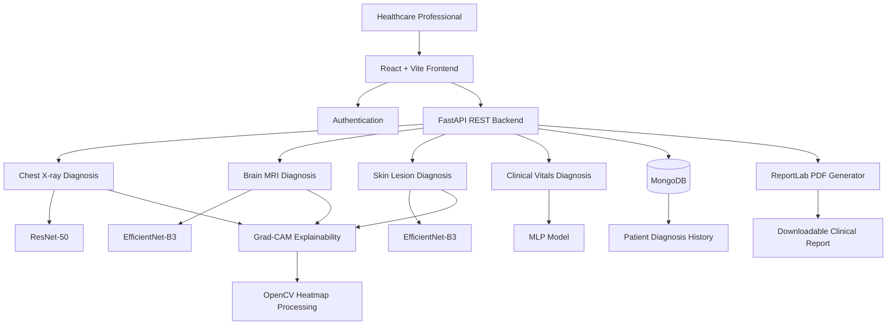
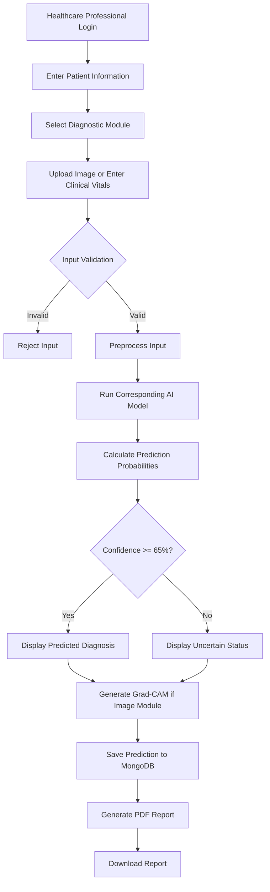

# 🏥 MediAI Diagnostics
### AI-Powered Multimodal Healthcare Diagnosis & Clinical Risk Prediction System

<p align="center">
  A multimodal AI-powered clinical decision-support platform combining medical image analysis, deep learning, explainable AI, and clinical risk prediction.
</p>

<p align="center">
  
  
  
  
  
</p>

---

## 📌 Project Overview

**MediAI Diagnostics** is an AI-powered multimodal healthcare diagnosis and clinical risk prediction web application designed to assist healthcare professionals in analyzing medical images and clinical health indicators.

The platform combines four independent diagnostic modules within a unified web application:

1. Chest X-ray analysis for pneumonia detection.
2. Brain MRI analysis for brain tumor classification.
3. Skin lesion analysis for dermatoscopic image classification.
4. Clinical vitals analysis for diabetes risk prediction.

The system integrates deep learning models built with PyTorch, a React-based frontend, a FastAPI backend, MongoDB persistence, and Explainable AI using Grad-CAM.

Beyond generating predictions, the platform incorporates reliability mechanisms such as image validity checks, out-of-distribution input rejection, confidence-threshold gating, and an explicit uncertain prediction state.

The project is developed as **Capstone Project II**, extending an earlier prototype with expanded diagnostic capabilities, retrained models, explainability, automated PDF reports, and improved reliability.

## 🎯 Project Objectives

- Develop a unified multimodal medical diagnosis platform.
- Detect pneumonia from chest X-ray images.
- Classify brain MRI scans into four diagnostic categories.
- Classify dermatoscopic skin lesion images into seven categories.
- Predict diabetes risk using 21 clinical health indicators.
- Apply Explainable AI to visualize model attention.
- Improve prediction reliability through input validation and confidence thresholds.
- Maintain patient diagnosis history.
- Generate downloadable PDF diagnostic reports.
- Provide a structured interface for healthcare professionals.

---

## ✨ Key Features

### 1. User Authentication & Management

The application provides an authenticated environment for healthcare professionals.

Features include:
- User registration.
- User login.
- Account management.
- Email-based login identification.
- Authenticated access to diagnostic functionality.
- User-associated diagnosis records.

The documented application has one primary user role: **Healthcare Professional**. A separate administrator interface is not included in this release.

### 2. Chest X-ray & Diabetes Analysis

<details>
<summary><b>View module details</b></summary>

The Chest X-ray module analyzes uploaded chest radiographs to identify pneumonia-related conditions.

**Deep Learning Architecture:** ResNet-50

The module supports:
- Patient information entry.
- Chest X-ray image upload.
- Image preprocessing.
- Pneumonia classification.
- Class probability breakdown.
- Risk score generation.
- Clinical vitals input.
- Diabetes risk prediction.
- Diagnosis history storage.
- Grad-CAM explainability.
- PDF diagnostic report generation.

The module also integrates diabetes risk prediction using patient-provided clinical health indicators.

**Diabetes Model:** Multi-Layer Perceptron (MLP)

The clinical model uses 21 health indicators to generate a diabetes prediction, associated probabilities, and a risk score.

</details>

### 3. Brain MRI Analysis

<details>
<summary><b>View module details</b></summary>

The Brain MRI module analyzes brain MRI scans to classify four categories:

- Glioma
- Meningioma
- Pituitary
- No Tumor

**Deep Learning Architecture:** EfficientNet-B3

**Dataset:** Brain Tumor MRI Dataset, containing 6,507 deduplicated images.

Features:
- Patient information entry.
- MRI scan upload.
- Image preprocessing.
- Four-class brain tumor classification.
- Prediction probability breakdown.
- Clinical risk score.
- Confidence-threshold evaluation.
- Grad-CAM attention heatmap.
- Original-versus-heatmap visualization.
- Downloadable PDF diagnostic report.
- MongoDB-backed prediction history.

</details>

### 4. Skin Lesion Detection

<details>
<summary><b>View module details</b></summary>

The Skin Lesion module analyzes dermatoscopic photographs to classify seven skin lesion categories.

**Deep Learning Architecture:** EfficientNet-B3

**Dataset:** HAM10000 (Human Against Machine with 10000 training images).

The module includes:
- Patient information entry.
- Dermatoscopic image upload.
- Image preprocessing.
- Seven-class lesion classification.
- Class probability breakdown.
- Risk score generation.
- Confidence-threshold gating.
- Grad-CAM attention heatmap.
- Original image and heatmap comparison.
- Automated PDF diagnostic report.

The model supports melanoma-related lesion classification as part of its seven-class diagnostic workflow.

</details>

### 5. Clinical Vitals & Diabetes Risk Prediction

The clinical module uses patient health indicators to estimate diabetes risk.

**Model Architecture:** Multi-Layer Perceptron (MLP)

**Input:** 21 clinical health indicators.

Outputs include:
- Diabetes prediction label.
- Risk score (0–100).
- Class probability breakdown.

The diabetes prediction is integrated into the Chest X-ray + Diabetes diagnostic workflow.

### 6. Explainable AI — Grad-CAM

MediAI Diagnostics incorporates **Gradient-weighted Class Activation Mapping (Grad-CAM)** to make image-based predictions more interpretable.

Grad-CAM generates visual heatmaps highlighting image regions that contribute to the model's prediction.

Implemented for:
- Chest X-ray analysis.
- Brain MRI analysis.
- Skin lesion detection.

The platform displays:
- Original medical image.
- AI-generated attention heatmap.
- Heatmap overlay.
- Visual comparison for interpretation.

OpenCV is used in the image-processing and heatmap generation pipeline.

### 7. Reliability & Prediction Validation

The platform includes mechanisms intended to reduce unreliable diagnostic outputs.

**Out-of-distribution input rejection**

Heuristic image checks reject inputs that do not statistically resemble the expected scan type.

**Confidence-threshold gating**

The system uses a documented confidence threshold of **65%**.

Predictions below this threshold are reported as:

`Uncertain`

Instead of forcing a potentially unreliable diagnostic classification, the system explicitly communicates uncertainty.

**Checkpointed model training**

Model training supports checkpointing and resumable training to improve resilience during long GPU training runs.

### 8. Automated PDF Diagnostic Reports

The system generates downloadable clinical diagnostic reports on demand.

**Backend endpoint:**

`POST http://127.0.0.1:8000/generate-report`

The generated reports include relevant diagnostic information such as:
- Report date and identification.
- Patient information.
- Diagnostic module.
- Predicted condition.
- Risk score.
- Class probabilities.
- Original medical image.
- Grad-CAM attention visualization.
- Diagnostic status.

PDF reports are generated using **ReportLab** and downloaded through the browser.

### 9. Patient History & MongoDB Persistence

The application stores user accounts and diagnosis records in MongoDB.

The documented collections include:

- `users`
- `predictions`

Stored diagnosis information includes:
- Patient ID.
- Patient name.
- Age and gender.
- Diagnostic module.
- Predicted diagnosis.
- Risk score.
- Class probabilities.
- Diabetes prediction information, where applicable.
- Healthcare professional who performed the diagnosis.
- Timestamp.

---

## 🧠 AI & Deep Learning Architecture

The platform uses four independent PyTorch diagnostic models.

| Diagnostic Module | Model Architecture | Task |
|---|---|---|
| Chest X-ray | ResNet-50 | Pneumonia detection |
| Brain MRI | EfficientNet-B3 | Four-class brain tumor classification |
| Skin Lesion | EfficientNet-B3 | Seven-class skin lesion classification |
| Clinical Vitals | MLP | Diabetes risk prediction |

### Model Training Methodology

According to the project documentation, the diagnostic models were retrained using larger, better-sourced public medical datasets.

The documented training methodology includes:

1. Dataset acquisition and preparation.
2. Data cleaning and preprocessing.
3. Stratified train, validation, and test splitting.
4. Transfer learning using ImageNet-pretrained backbones for image models.
5. Class-weighted loss to address imbalanced disease classes.
6. GPU-based training with mixed precision.
7. Early stopping to control overfitting.
8. Model evaluation using held-out data.
9. Checkpoint saving.
10. Resumable training support.
11. Integration of trained checkpoints into the FastAPI inference pipeline.

### Medical Datasets

| Dataset | Application | Documented Information |
|---|---|---|
| RSNA Pneumonia Detection Challenge | Chest X-ray | Pneumonia detection |
| Brain Tumor MRI Dataset | Brain MRI | 6,507 images, four classes |
| HAM10000 | Skin Lesion | Dermatoscopic lesion classification |
| CDC BRFSS 2015 Diabetes Health Indicators | Clinical Vitals | Diabetes risk prediction |

**Dataset References:**

- RSNA: https://www.kaggle.com/c/rsna-pneumonia-detection-challenge
- Brain MRI: https://www.kaggle.com/
- HAM10000: https://www.kaggle.com/datasets/kmader/skin-cancer-mnist-ham10000
- Diabetes: https://www.kaggle.com/datasets/alexteboul/diabetes-health-indicators-dataset

---

## 🏗️ System Architecture

The application follows a full-stack architecture with a React/Vite frontend communicating with a Python FastAPI backend through REST APIs.



### Diagnosis Workflow



---

## 🛠️ Technology Stack

| Layer | Technologies |
|---|---|
| Frontend | React.js, JavaScript |
| Frontend Build Tool | Vite |
| Backend | Python, FastAPI |
| API Communication | REST APIs |
| Deep Learning | PyTorch |
| Model Architectures | ResNet-50, EfficientNet-B3, MLP |
| Computer Vision | OpenCV |
| Image Processing | PyTorch, Torchvision |
| Explainable AI | Grad-CAM |
| Machine Learning Utilities | scikit-learn |
| Database | MongoDB |
| PDF Generation | ReportLab |
| Version Control | Git, GitHub |

---

## 🗄️ Database Design

MediAI Diagnostics uses MongoDB as its NoSQL database.

### Collection: `users`

| Field | Type | Description |
|---|---|---|
| `_id` | ObjectId | Unique document identifier |
| `username` | String | Healthcare professional's name |
| `email` | String | Unique login identifier |
| `password` | String | Account password field in the documented schema |
| `created_at` | DateTime | Account creation timestamp |

### Collection: `predictions`

| Field | Type | Description |
|---|---|---|
| `_id` | ObjectId | Unique prediction identifier |
| `patient_id` | String | Patient identifier |
| `patient_name` | String | Patient name |
| `patient_age` | String | Patient age |
| `patient_gender` | String | Patient gender |
| `module` | String | Diagnostic module |
| `diagnosis` | String | Predicted diagnosis or Uncertain |
| `risk_score` | Integer | Risk score, 0–100 |
| `probabilities` | Object | Per-class probability values |
| `vitals_diagnosis` | String | Diabetes prediction, when applicable |
| `vitals_risk_score` | Integer | Diabetes risk score |
| `vitals_probabilities` | Object | Diabetes class probabilities |
| `saved_by` | String | Healthcare professional who performed diagnosis |
| `timestamp` | DateTime | Record creation timestamp |

---

## 📂 Project Modules

The project is organized around the following logical components:

```text
MediAI-Diagnostics/
│
├── frontend/
│   ├── React application
│   ├── Authentication screens
│   ├── Diagnostic modules
│   ├── Patient information forms
│   ├── Result visualizations
│   └── Report download interface
│
├── backend/
│   ├── FastAPI application
│   ├── Authentication services
│   ├── Diagnostic inference services
│   ├── Image preprocessing
│   ├── Grad-CAM generation
│   ├── MongoDB integration
│   └── PDF report generation
│
├── models/
│   ├── Chest X-ray ResNet-50
│   ├── Brain MRI EfficientNet-B3
│   ├── Skin Lesion EfficientNet-B3
│   └── Clinical Vitals MLP
│
└── README.md
```

*This is a logical overview of the system, not a verified file-by-file directory listing. Refer to the actual repository for the implementation structure.*

---

## ⚙️ Installation & Setup

### Prerequisites

Install the following:

- Python 3.10 or a compatible version for the project's dependencies.
- Node.js and npm.
- MongoDB.
- Git.
- A compatible PyTorch environment.
- GPU support if using CUDA-based inference or training.

### 1. Clone the Repository

```bash
git clone YOUR_REPOSITORY_URL

cd MediAI-Diagnostics
```

Replace `YOUR_REPOSITORY_URL` with the actual GitHub repository URL.

### 2. Backend Setup

Navigate to the backend directory:

```bash
cd backend
```

Create a virtual environment:

```bash
python -m venv venv
```

Activate it on Windows:

```powershell
venv\Scripts\activate
```

Install dependencies:

```bash
pip install -r requirements.txt
```

Configure the required environment variables, including the MongoDB connection details and application configuration.

Start the FastAPI server using the actual application entry point:

```bash
uvicorn main:app --reload
```

If the application entry point is inside a Python package, adjust the module path accordingly.

### 3. Frontend Setup

Open a separate terminal and navigate to the frontend directory:

```bash
cd frontend
```

Install dependencies:

```bash
npm install
```

Start the development server:

```bash
npm run dev
```

Open the local URL printed by Vite.

### 4. API Documentation

The FastAPI interactive documentation is generally available at:

```text
http://127.0.0.1:8000/docs
```

### 5. PDF Report Endpoint

The documented report-generation endpoint is:

```http
POST /generate-report
```

Local development endpoint:

```text
http://127.0.0.1:8000/generate-report
```

---

## 🖥️ Application Screens

The documentation demonstrates the following interfaces:

| Screen | Description |
|---|---|
| Landing Page | Project overview and diagnostic highlights |
| Login | Healthcare professional authentication |
| Chest X-ray + Diabetes | Patient details and clinical vitals |
| Chest X-ray Results | Diagnosis and probability breakdown |
| Brain MRI | MRI upload and four-class diagnosis |
| Brain MRI Results | Risk score and class probabilities |
| Brain MRI Grad-CAM | Original image and attention overlay |
| Skin Lesion | Patient details and lesion image upload |
| Skin Lesion Results | Seven-class probability breakdown |
| Skin Lesion Grad-CAM | Lesion attention visualization |
| PDF Reports | Downloadable clinical diagnostic reports |

---

## 🔒 Security & Clinical Safety Considerations

MediAI Diagnostics is designed as a **clinical decision-support prototype**, not an autonomous diagnostic system.

Important considerations:

- Predictions must be reviewed by qualified healthcare professionals.
- AI-generated results must not replace clinical examinations or professional medical judgment.
- Low-confidence predictions are explicitly marked Uncertain.
- Invalid or out-of-distribution images are subject to rejection.
- Patient data must be protected through appropriate access controls.
- Passwords must be securely hashed before production deployment. The current documented schema describes a plain string password field; this should not be treated as a production-safe password-storage design.
- Medical images and reports should be stored and transmitted securely.
- The models require independent clinical validation before real-world clinical use.

---

## 🚀 Future Enhancements

Potential development directions include:

- Expanded medical imaging datasets.
- External clinical validation.
- Improved out-of-distribution detection.
- Enhanced model calibration.
- More advanced clinical risk stratification.
- Additional diagnostic modules.
- Improved patient record management.
- Secure role-based access control.
- Deployment monitoring and model performance tracking.
- More comprehensive clinical explainability.

---

## 👨‍💻 Project Contributors

**Capstone Project II — Integrated Master of Science (IT)**

**1. Shah Khush Prakashbhai**  
Enrollment No: `202201619010082`

**2. Trivedi Naman Ravikumar**  
Enrollment No: `202201619010107`

**Institution:** GLS University  
Faculty of Computer Applications & Information Technology  
**Academic Year:** 2026–2027

**Project Guide:** Dr./Prof. Nandita Sharma

---

## 📚 References

### Frameworks & Libraries

- FastAPI — https://fastapi.tiangolo.com/
- PyTorch — https://pytorch.org/
- React — https://react.dev/
- Vite — https://vite.dev/
- MongoDB — https://www.mongodb.com/
- ReportLab — https://www.reportlab.com/
- scikit-learn — https://scikit-learn.org/
- OpenCV — https://opencv.org/

### Datasets

- RSNA Pneumonia Detection Challenge
- Brain Tumor MRI Dataset
- HAM10000 Skin Lesion Dataset
- CDC BRFSS 2015 Diabetes Health Indicators Dataset

---

<p align="center">
  <b>MediAI Diagnostics</b><br/>
  Advancing multimodal healthcare analysis through deep learning, explainable AI, and clinical decision support.
</p>
